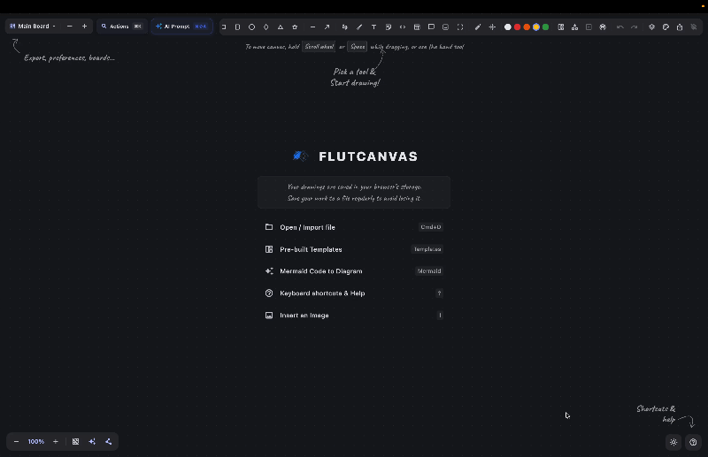

# 🎨 FlutCanvas

> An infinite virtual whiteboard, diagramming, and visual thinking canvas built with Flutter, Clean Architecture, and BLoC.

<p align="center">
  
</p>

FlutCanvas is a modern, lightweight, and extensible digital whiteboard designed for visual thinkers, software architects, teams, and presenters. Combining freehand sketching, smart magnetic diagramming, AI-driven generation, local network live broadcasting, presentation frames, and architecture icon libraries, FlutCanvas delivers a seamless visual workspace across Web, Desktop (macOS, Windows, Linux), and Tablets.

---

## ✨ Features Overview

### 🤖 AI Text-to-Diagram Generator (`Ctrl/Cmd + Shift + A`)
- **Natural Language to Visual Diagrams**: Prompt AI to generate flowcharts, cloud architectures, mind maps, sequence diagrams, and process workflows directly onto native canvas nodes.
- **Multi-Provider Support**: Integrated with **Google Gemini** (defaulting to `gemini-3.8-flash` with automatic fallback chain: `gemini-2.5-flash`, `gemini-2.0-flash`, `gemini-1.5-flash`, `gemini-1.5-pro`) and zero-configuration browser-native **`window.ai`**.
- **Real-Time Token Streaming HUD**: Live streaming token preview with interactive terminal output and step-by-step progress tracking (Prompting → Generating → Parsing → Canvas Layout).
- **Collision-Free Auto-Layout**: Automated layout engine with expanded rank spacing and collision prevention to avoid subgraph and label overlapping.

### ✍️ Freehand & Handwritten Shape Recognition
- **Smooth Pen & High-Vibrance Highlighter**: High-performance drawing brushes with opacity and dark/light mode contrast preservation.
- **Smart Shape Auto-Correction**: Draw rough hand-sketched shapes (rectangles, rounded boxes, circles, ellipses, triangles, diamonds, stars, arrows) and hold for ~380ms to automatically snap into clean, crisp geometric vectors.

### 📡 Zero-Cloud LAN Live Broadcast & Presenter Sync (`Alt + B`)
- **Desktop Host Engine (macOS, Windows, Linux)**: Presenters host directly from the desktop application using an embedded native HTTP and WebSocket server (`dart:io`) on your local Wi-Fi / LAN (default port 4040, automatic fallback to 4041–4049). *(Note: Web browsers cannot host because browser sandboxes prevent binding raw local network server sockets).*
- **Universal Cross-Platform Audience Viewer**: Audience members can join from **any device** (iOS, Android, macOS, Windows, Linux, Chromebooks) via any standard web browser with zero app installation.
- **100% Offline & Private**: Zero external CDN scripts or cloud servers required; works completely offline on local Wi-Fi routers or mobile hotspots.
- **Real-Time Camera & Pointer Tracking**: Audience view smoothly tracks presenter pan, zoom, and framing with interpolated camera LERP, interactive "Follow Presenter" toggle, and live laser pointer sync (`K`).
- **Scan-to-Join QR Code Modal**: Instant QR code dialog allowing colleagues or students in meeting rooms and lecture halls to join instantly by scanning with their phone camera or opening the link.
- **Live Status HUD**: Pulsing emerald indicator with live connected viewer counter.

### ☁️ Cloud & Architecture Icon Library (`Alt + I`)
- **40+ Curated Architecture Components**: Cloud & Compute (AWS Lambda, EC2, Cloud Run, Azure Functions), Databases (PostgreSQL, MySQL, Redis, MongoDB, Cassandra, DynamoDB, S3), Messaging & Networking (Kafka, RabbitMQ, GraphQL, NGINX, Cloudflare, Webhooks), DevOps (Docker, Kubernetes, Jenkins, GitLab, GitHub, Terraform), and Client Devices (Web, Mobile, Desktop, IoT, IAM).
- **Instant Search Drawer**: Category filters, real-time query search, and one-click insertion.
- **Vector & Mermaid Interoperability**: Icons render with brand color badges and export cleanly to Vector SVG, Mermaid markdown, and PNG.

### 🔍 Command Palette & Spotlight (`Ctrl/Cmd + K`)
- Fast keyboard-driven command runner to switch tools, invoke actions, toggle theme/grid/layers/icons, insert architecture components directly, and search on-canvas text with instant camera zoom-and-focus.

### 📊 Tables & Tabular Grid Elements
- **Native Table Blocks**: Create customizable tabular grids for architecture comparison matrices, data dictionaries, and feature checklists.
- **Interactive Cell Editing**: Double-click or press `Tab` to navigate and edit cell text.
- **Configurable Geometry & Styles**: Add/remove rows and columns, adjust borders, padding, and fills directly from the toolbar.

### 💬 Canvas Comments & Review Pins
- **Threaded Review Notes**: Drop review pins anywhere on the canvas or attach them to specific elements.
- **Discussion Threads**: Add replies, mark comments as resolved, and track feedback directly in the visual workspace.

### 🗂️ Layers Sidebar & Element Locking (`Alt + L`)
- **Visual Object Tree**: Inspect all canvas elements, their z-index hierarchy, types, and labels.
- **Element Locking (`Ctrl/Cmd + L`)**: Lock elements to prevent accidental dragging, deletion, or resizing.
- **Visibility & Z-Order Management**: One-click toggle for visibility and quick bring-to-front / send-to-back controls.

### 🔗 Smart Magnetic Connectors & Routing
- **Magnetic Anchors**: Automatic anchor detection (top, bottom, left, right) on all shapes.
- **Dynamic Follow-Through**: Connectors dynamically follow connected nodes when moved or resized.
- **Routing Modes**: Straight lines, orthogonal / elbow step routing, and smooth curved Bézier connectors.

### 📐 Infinite Canvas, Navigation & Alignment
- **Infinite Viewport**: Pan freely with middle-click, `Space + Drag`, or the Hand tool (`H`).
- **Zoom Range**: Zoom smoothly from 10% to 800% with mouse wheel or on-screen controls.
- **Minimap**: Interactive minimap for instant spatial awareness and quick jumping.
- **Grid Snapping (`G`) & Smart Guides (`S`)**: 24px coordinate grid snapping and real-time magnetic alignment guidelines with equal-spacing hints.
- **Align & Distribute**: One-click alignment (Left, Center, Right, Top, Middle, Bottom) and equal spacing distribution (Horizontally and Vertically).

### 🎭 Presentation Mode & Laser Pointer (`F5`, `K`)
- **Slide Frames (`F`)**: Define presentation frames and slide boundaries on your canvas.
- **Presentation Deck Viewer (`F5`)**: Step sequentially through slides with animated zoom-to-fit camera framing.
- **Laser Pointer (`K`)**: Ephemeral glowing laser trail with auto-decay for live walkthroughs and demos.

### 🌓 Animated High-Contrast Dark & Light Mode (`Alt + Shift + D`)
- **Circular Clip Reveal Animation**: Smooth circular transition when toggling between dark and light themes.
- **Smart Contrast Handling**: Pure white and dark palette preservation, high-contrast text contrast inversion, and adaptive toolbar icons.

### 🚀 Import, Export & Interoperability
- **High-Res PNG**: Export full board or selection with transparent or solid background.
- **Scalable Vector SVG**: Crisp, resolution-independent vector export preserving shapes, strokes, and tech icons.
- **Multi-Page Presentation PDF**: Export frames as sequential presentation slides.
- **Bidirectional Mermaid Flowcharts (`.mmd`)**: Parse Mermaid markdown into editable canvas elements and export visual diagrams back to clean Mermaid flowchart syntax.
- **Excalidraw Import**: Open and load `.excalidraw` JSON diagrams.
- **Clipboard Integration**: Copy/paste shapes, text, images, and Mermaid definitions across boards or system clipboard.

---

## ⌨️ Keyboard Shortcuts Reference

| Shortcut | Action |
| :--- | :--- |
| **`Ctrl/Cmd + Shift + A`** | **AI Text-to-Diagram Prompt Bar** |
| **`Ctrl/Cmd + K`** | **Command Palette / Spotlight Search** |
| **`Alt + B`** | **Toggle LAN Live Broadcast Dialog** |
| **`Alt + I`** | **Toggle Cloud & Tech Icon Library** |
| **`Alt + L`** | **Toggle Layers & Object Tree Sidebar** |
| **`Alt + Shift + D`** | **Toggle Light / Dark Theme** |
| **`V`** | Select / Transform Tool |
| **`H`** / **`Space + Drag`** | Hand / Pan Canvas |
| **`R`** / **`Shift + R`** | Rectangle / Rounded Box |
| **`O`** | Ellipse / Circle |
| **`D`** | Diamond |
| **`Shift + T`** | Triangle |
| **`L`** / **`A`** | Line / Arrow Connector |
| **`P`** / **`M`** | Pen / Highlighter |
| **`T`** / **`N`** | Text / Sticky Note |
| **`C`** | Syntax-Highlighted Code Block |
| **`E`** | Eraser |
| **`K`** | Laser Pointer |
| **`F`** | Slide Frame |
| **`I`** | Insert Image |
| **`G`** | Toggle Grid Snapping (24px) |
| **`S`** | Toggle Smart Magnetic Alignment Guides |
| **`Ctrl/Cmd + Z`** | Undo |
| **`Ctrl/Cmd + Shift + Z`** / **`Ctrl/Cmd + Y`** | Redo |
| **`Ctrl/Cmd + C`** / **`Ctrl/Cmd + V`** | Copy / Paste |
| **`Ctrl/Cmd + D`** | Duplicate Selected |
| **`Ctrl/Cmd + A`** | Select All |
| **`Ctrl/Cmd + L`** | Lock / Unlock Selected Elements |
| **`Ctrl/Cmd + G`** / **`Ctrl/Cmd + Shift + G`** | Group / Ungroup Selected |
| **`Ctrl/Cmd + ]`** / **`Ctrl/Cmd + [`** | Bring to Front / Send to Back |
| **`Delete`** / **`Backspace`** | Delete Selected |
| **`Ctrl/Cmd + O`** | Open Diagram Templates Dialog |
| **`Ctrl/Cmd + E`** | Open Export Dialog |
| **`F5`** | Start Presentation Mode |
| **`?`** / **`Shift + /`** | Open Keyboard Shortcuts Help |
| **`Esc`** | Exit Presentation / Deselect All / Close Dialogs |

---

## 🏛️ Clean Architecture & Project Structure

FlutCanvas is structured using **Feature-First Clean Architecture** with **BLoC** for state management, **Freezed** for immutable domain models, and **GetIt + Injectable** for dependency injection.

```
lib/
├── main.dart                               # Application entry point & service bootstrap
├── app/
│   ├── app.dart                            # Root MaterialApp & theme setup
│   ├── providers/                          # MultiBlocProvider configuration
│   └── view/                               # Root AppView with ScreenUtil initialization
│
├── core/                                   # Cross-cutting foundational modules
│   ├── constants/                          # BoardColors and canvas palette constants
│   ├── di/                                 # GetIt + Injectable configuration
│   ├── error/                              # Failure definitions & domain errors
│   ├── extensions/                         # Rect, Offset, and Matrix4 math helpers
│   ├── services/                           # Platform services (clipboard, downloader, media)
│   ├── theme/                              # AppTheme & color schemes
│   ├── utils/                              # Result<T> and pure geometric utilities
│   └── widgets/                            # CircularThemeReveal animation widget
│
└── features/                               # Self-contained business capability modules
    ├── ai_diagram/                         # AI text-to-diagram generation
    │   ├── data/                           # Gemini API client, window.ai service & templates
    │   ├── domain/                         # AI diagram models & repository contract
    │   └── presentation/                   # AiDiagramCubit & prompt bar dialog with streaming HUD
    │
    ├── broadcast/                          # Local network live presenter sync
    │   ├── data/                           # Embedded HTTP & WebSocket server, IP resolver
    │   ├── domain/                         # Broadcast messages & models
    │   └── presentation/                   # BroadcastCubit, QR modal & viewer count HUD
    │
    ├── canvas/                             # Core infinite canvas engine
    │   ├── data/                           # SharedPreferences repo, routing, Mermaid & shape recognition
    │   ├── domain/                         # Freezed models (BoardElement, etc.), commands & use cases
    │   └── presentation/                   # CanvasBloc, Viewport & Interaction controllers, tools, painters
    │
    ├── clipboard/                          # Cross-platform clipboard coordination
    ├── comments/                           # Threaded comments, pins & popovers
    ├── export/                             # PNG, SVG, PDF, Mermaid & JSON export services & dialog
    ├── layers/                             # Layers sidebar, object tree, lock/visibility toggles
    ├── presentation_mode/                  # Slide deck viewer & camera zoom-to-fit
    └── toolbar/                            # Main toolbar & responsive properties panel
```

---

## 🛠️ Getting Started

### Prerequisites
- [Flutter SDK](https://docs.flutter.dev/get-started/install) (`>=3.13.3`)
- [Dart SDK](https://dart.dev/get-dart) (`>=3.13.3`)
- For macOS: Xcode & CocoaPods (`sudo gem install cocoapods`)

### Installation & Run

1. **Clone the repository:**
   ```bash
   git clone https://github.com/your-username/flutcanvas.git
   cd flutcanvas
   ```

2. **Install dependencies:**
   ```bash
   flutter pub get
   ```

3. **Generate code (Freezed & Injectable):**
   ```bash
   dart run build_runner build --delete-conflicting-outputs
   ```

4. **Run on your target platform:**
   - **Web:**
     ```bash
     flutter run -d chrome
     ```
   - **macOS Desktop:**
     ```bash
     flutter run -d macos
     ```
   - **Windows / Linux:**
     ```bash
     flutter run -d windows # or linux
     ```

5. **Build for production:**
   ```bash
   flutter build web --release
   flutter build macos --release
   ```

---

## 🧪 Testing

FlutCanvas features a comprehensive test suite covering domain use cases, BLoC state transitions, shape recognition accuracy, live broadcast message framing, and widget interactions:

```bash
flutter test
```

---

## 📄 License

This project is licensed under the [MIT License](LICENSE).
